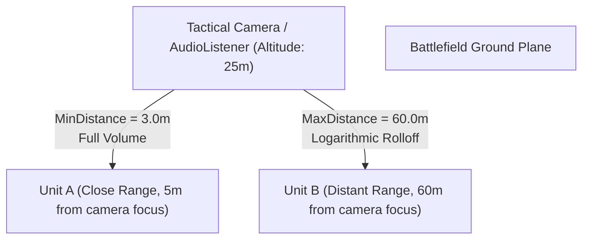

# Unity 3D Audio Spatialization Guide for Rogue Command

This reference explains the mathematical and architectural requirements for 3D spatial sound in Rogue Command's overhead tactical camera perspective.

---

## 1. The Mono Invariant for 3D Positional Audio

In Unity's audio engine, **3D spatial attenuation, distance rolloff, and directional panning only work on Mono (1-channel) audio clips**.

### Why Stereo Fails in 3D Space
When a stereo clip (2 channels) is assigned to an `AudioSource` with `spatialBlend = 1.0`:
1. Unity cannot collapse two independent stereo channels into a single spatial point source without severe phase cancellation.
2. Unity falls back to playing the stereo channels flat across the listener's left/right ears, completely eliminating world-space distance attenuation.
3. The player hears distant gunfire at full volume as if it were happening right in front of the camera.

> [!CRITICAL]
> All in-game unit audio (cannon blasts, machine gun bursts, engine hums, explosions, impacts) **MUST be exported as Mono (1 channel)**. Reserve Stereo clips exclusively for 2D UI elements (`UIClickSound`) and non-diegetic background music.

---

## 2. AudioSource Parameter Calibration for RTS Cameras

In an RTS game like Rogue Command, the audio listener is attached to the tactical camera, hovering 15 to 40 meters above the battlefield terrain. Standard first-person audio settings produce unnatural results unless calibrated for this geometry:

### Verified Native Settings
| Parameter | Calibrated Value | Rationale |
|:---|:---:|:---|
| **Spatial Blend** | `1.0` (100% 3D) | Ensures full distance attenuation and horizontal/vertical panning. |
| **Rolloff Mode** | `Logarithmic` | Natural acoustic decay matching inverse-square sound propagation. |
| **Min Distance** | `3.0m` | Sound remains at 100% volume within 3 meters of emitter. |
| **Max Distance** | `60.0m – 80.0m` | Matches the visible frustum radius of the Rogue Command tactical camera. |
| **Doppler Level** | `0.0` (or $\le 0.1$) | **Crucial:** When players rapidly drag the camera across the map, non-zero doppler causes jarring, unrealistic pitch warbles. Set to 0.0. |
| **Spread** | `0.0` | Discrete point source for crisp tactical localization. |

---

## 3. Priority Allocation Table

Unity allocates a limited number of active hardware/software audio voices (typically 32 to 64 simultaneous voices). When hundreds of units clash, low-priority sounds must yield to critical combat cues:

| Audio Event Type | AudioSource Priority | Voice Stealing Behavior |
|:---|:---:|:---|
| **Nuclear / Heavy Artillery Detonation** | `16 – 32` | Highest priority; never cut off. |
| **Direct Combat Weapon Fire** | `48 – 64` | High priority; ensures player hears active attacks. |
| **Impact / Armor Ricochet / Shield Deflection** | `96 – 112` | Medium priority. |
| **Vehicle Engine / Movement Loop** | `128` | Standard priority; can be stolen if army is massive. |
| **Turret Traverse / Idle Mechanical Humming** | `160 – 192` | Low priority; safe to cull under heavy combat load. |
