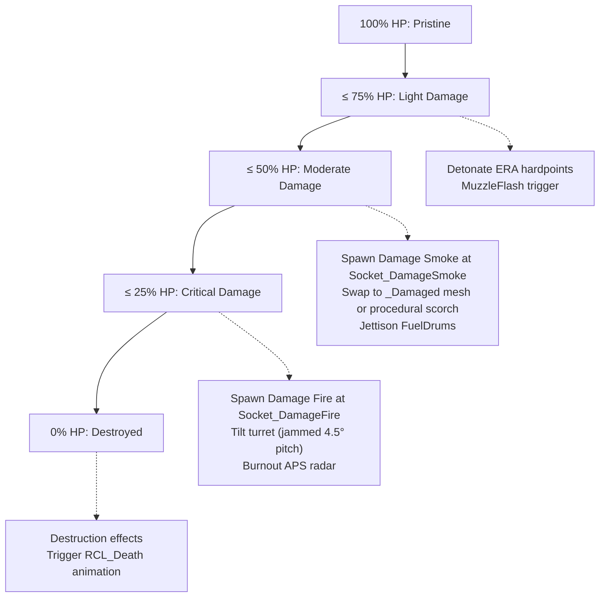

# Native VFX Integration Points in Rogue Command

This reference details the reverse-engineered integration points and automatic discovery mechanisms in Rogue Command 1.0.9 (`Assembly-CSharp.dll`). By authoring visual prefabs to match these conventions, modded vehicles receive native visual effects, muzzle flashes, and damage degradation **without writing any custom C# gameplay scripts**.

---

## 1. Automatic Muzzle Flash Discovery (`ShootProjectile`)

Inspection of `ShootProjectile.Init()` in `Assembly-CSharp.dll` reveals that Rogue Command automatically crawls the child hierarchy of every firepoint at match startup:

```csharp
// ShootProjectile.Init()
for (int i = 0; i < this.firePointsTransform.childCount; i++)
{
    Transform child = this.firePointsTransform.GetChild(i);
    this._firePoints.Add(child);
    if (child.childCount >= 1)
    {
        // Automatically discovers the ParticleSystem at child index 0!
        this._muzzleFlashEffects.Add(child.GetChild(0).GetComponent<ParticleSystem>());
    }
}

// ShootProjectile.ShootFromFirepoint(int firePointIndex)
if (this._muzzleFlashEffects.Count > firePointIndex && this._muzzleFlashEffects[firePointIndex] != null)
{
    this._muzzleFlashEffects[firePointIndex].Play();
}
```

### Hierarchy Recipe for Guns and Turrets
To integrate weapon muzzle flashes with native firing logic:
```
VehicleVisualPrefab
└── Socket_TurretPivot
    └── Socket_TurretPitch
        └── FirePoints / Socket_MuzzlePrimary (Transform)
            ├── FirePoint_0 (Transform)
            │   └── MuzzleFlash_0 (GameObject with ParticleSystem at Child Index 0)
            └── FirePoint_1 (Transform, if multi-barrel)
                └── MuzzleFlash_1 (GameObject with ParticleSystem at Child Index 0)
```
- **Rule**: The `ParticleSystem` **must be child index 0** of each individual firepoint transform.
- **Rule**: Set `playOnAwake = false` and `looping = false` on the muzzle flash emitter.

---

## 2. Serialized Status Particle Systems (`EntityController`)

Native `EntityController` components serialize 7 dedicated `ParticleSystem` fields for visual status feedback, plus a destruction prefab:

| Field Name | Type | Trigger Condition in Native Engine |
|:---|:---|:---|
| `beingHealedParticleSystem` | `ParticleSystem` | Active while receiving repairs or green repair aura. |
| `chargeShieldParticleSystem` | `ParticleSystem` | Plays upon receiving a shield charge or deflecting a projectile. |
| `slowedDownParticleSystem` | `ParticleSystem` | Active while affected by EMP, cryogenic slowing, or mire. |
| `combatBoostParticleSystem` | `ParticleSystem` | Active during damage buff or frenzy aura. |
| `speedUpParticleSystem` | `ParticleSystem` | Active during haste or turbo-drive acceleration. |
| `stunnedParticleSystem` | `ParticleSystem` | Active while disabled or stunned by shock tanks. |
| `onFireParticleSystem` | `ParticleSystem` | Active while burning from incendiary weapons or thermal hazards. |
| `destructionEffect` | `GameObject` | Instantiated at entity position when `CurrentHealth <= 0`. |

In native-template units (`nativeTemplateId`), these emitters are automatically inherited from the base vehicle prefab. In custom prefabs, providing child GameObjects matching these roles allows the engine to bind them directly.

---

## 3. Tiered Health Degradation (`RuntimeVisualDirector`)

The mod loader's `RuntimeVisualDirector` component manages physical vehicle degradation as health drops across 4 distinct thresholds:



### Damage Sockets and Anchors
1. **`Socket_DamageSmoke`**:
   - Evaluated when `HealthRatio <= 0.50f`.
   - Spawns dense black smoke particles. If missing, director falls back to vehicle root.
   - Ideal location: Engine exhaust deck, radiator louvers, or turret ring.
2. **`Socket_DamageFire`**:
   - Evaluated when `HealthRatio <= 0.25f`.
   - Spawns active fire/ember emitter. If missing, director falls back to vehicle root.
   - Ideal location: Fuel tanks, battery compartments, or engine bay.
3. **Hardpoint Sockets**:
   - `Socket_Hardpoint_ERA`: Detonates visually at $\le 75\%$ HP.
   - `Socket_Hardpoint_FuelDrums`: Jettisons and smokes at $\le 50\%$ HP.
   - `Socket_Hardpoint_APS`: Shuts down radar dish rotation at $\le 25\%$ HP.

---

## 4. Audio-Linked Particle Emitters (`ParticleSoundPlayer`)

Rogue Command provides a native component `ParticleSoundPlayer` for attaching 3D spatial audio to transient particle effects (explosions, ricochets, shell casing impacts):

- `AudioSource audioSource`: 3D spatial audio source attached to the particle emitter.
- `List<AudioClip> audioClips`: Pool of sound variations randomized on emission.
- `Vector2 pitchRange`: Pitch modulation bounds (e.g. `[0.95, 1.05]`) for acoustic variety.
- `ParticleSystem _particleSystem`: Emitter whose `Play()` triggers the sound.
