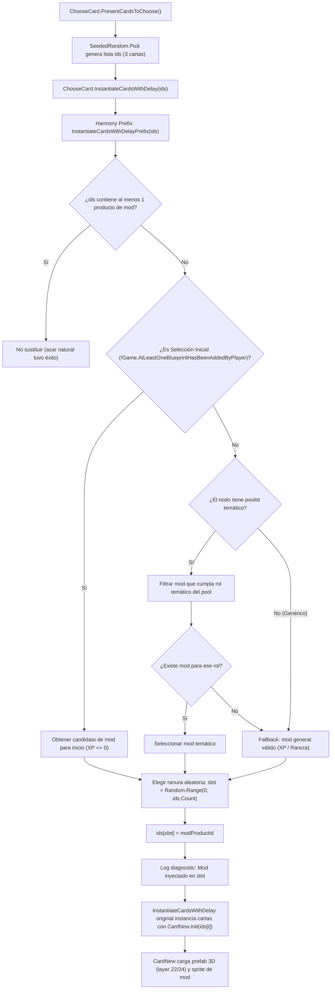

# Plan de Implementación: Aparición Garantizada y Carga Universal de Cartas y Unidades Modeadas

## 1. Resumen Ejecutivo y Diagnóstico con Ingeniería Inversa

Tras realizar la decompilación profunda de `Assembly-CSharp.dll` (`ChooseCard.cs`, `CardNew.cs`, `BlueprintPool.cs`, `EntityBalancingStore.cs`, `EntityFactory.cs`), el análisis de los paquetes de contenido (`sample-native-expansion`, `sample-reactive-ai`, `tactical-operations`) y el registro de eventos en vivo de BepInEx (`LogOutput.log` y `Player.log`), se determinaron las causas exactas por las cuales las cartas de unidades modeadas no se cargan ni se muestran al jugador:

1. **Exclusión Absoluta en Selección Inicial de Partida (`isAllowedAsStartingBlueprint`)**:
   - Al comenzar una *run* (antes del Nivel 1), el juego activa `flag = !Game.AtLeastOneBlueprintHasBeenAddedByPlayer` (`true`).
   - La consulta `EntityBalancingStore.AllEntityIdsAllowedAsBlueprints(rarity, startingBlueprints: true)` exige `isAllowedAsStartingBlueprint == true`.
   - En `tactical-operations`, el 100% de las unidades (`tidebreaker-skirmisher`, `skyguard-sam`, `salvage-hauler`) tienen `isAllowedAsStartingBlueprint: false`.
   - En `sample-native-expansion`, 8 de las 9 unidades tienen `false` (solo `arachnid-hexapod` tenía `true`).
   - **Consecuencia**: 11 de las 12 unidades modeadas nunca podían aparecer en la pantalla inicial.

2. **Desventaja Probabilística Extrema en Nodos de Recompensa (Niveles 1, 2 y 3)**:
   - En nodos con pool temático (ej. `BP_CheaperVehicles`), hay más de 20 unidades nativas compitiendo contra 0 o 1 unidad de mod.
   - En nodos genéricos globales (Nivel 2 y 3), más de 25 unidades nativas compiten contra candidatos de mods.
   - El generador `SeededRandom.Pick` extrae 3 cartas: la probabilidad matemática de que ninguna de las 3 sea de mod supera el 85%–90%. El jugador puede completar campañas enteras sin ver jamás una carta modeada.

3. **Cero Sustitución Activa en `ChooseCard.InstantiateCardsWithDelay`**:
   - En sesiones previas se detectó la necesidad de inyectar una opción garantizada, pero el hook prefix en `ChooseCard.InstantiateCardsWithDelay(List<string> ids)` **no había sido implementado en el código fuente**.

---

## 2. Decisiones de Diseño Acordadas en `/grill-me`

Durante la sesión interactiva se acordaron los siguientes requisitos directos:
- **Elegibilidad Inicial**: Las unidades modeadas deben ser elegibles como carta inicial antes de comenzar el Nivel 1, garantizando al menos una opción modeada en dicha pantalla.
- **Coincidencia Temática Inteligente**: Si el nodo de recompensa pertenece a un pool temático específico (Vehículos, Mechs, Robos, Tanques), la carta modeada debe coincidir con dicho rol temático (ej. `tidebreaker-skirmisher` en pool de Vehículos). Si no existe ninguna unidad modeada para ese rol específico, se ofrecerá un mod general válido que cumpla con el nivel de experiencia y rareza.
- **Posición Aleatoria del Slot**: Cuando ninguna carta de mod salga por azar, se sustituirá una ranura elegida al azar entre las 3 opciones generadas (`Random.Range(0, ids.Count)`), evitando que esté fija siempre en la misma posición.
- **Validación Integral**: Ejecución de las suites locales de pruebas C# y Python, compilación Release, empaquetado, despliegue de binarios en BepInEx y verificación de ejecución en vivo con BepInEx MCP sobre el perfil QA Profile2.

---

## 3. Arquitectura del Flujo de Inyección Garantizada

---

## 4. Tareas Atómicas de Implementación

### Tarea 1: Soporte de Carta Inicial Universal en el Cargador
- **Archivo:** [`src/RogueCommandExpansionLoader/Content/ContentPackRuntimeLoader.cs`](file:///c:/Users/Alex/Documents/Mod Rogue Command/src/RogueCommandExpansionLoader/Content/ContentPackRuntimeLoader.cs)
- En `AddInitialStageStartingFactories`: Permitir que todas las unidades y fábricas de mods con `neededExperienceLevel <= 0` sean registradas como elegibles para la selección inicial de partida.
- En `TryGetBlueprintPoolDecision`: Asegurar que durante la selección inicial (`isStartingBlueprintSelection == true`), las unidades de mods no sean descartadas si su `neededExperienceLevel <= 0`.

### Tarea 2: Algoritmo de Selección Temática y Fallback Garantizado
- **Archivo:** [`src/RogueCommandExpansionLoader/Content/ContentPackRuntimeLoader.cs`](file:///c:/Users/Alex/Documents/Mod Rogue Command/src/RogueCommandExpansionLoader/Content/ContentPackRuntimeLoader.cs)
- Implementar `TryGetGuaranteedModRewardProduct(string poolId, bool isStartingSelection, int currentXpLevel, Rarity desiredRarity, out string modProductId)`:
  1. Si `isStartingSelection == true`: Seleccionar un mod disponible no presente en `Game.CardsInDeck` con `neededExperienceLevel <= 0`.
  2. Si `poolId != null`: Evaluar el rol del pool (`Vehicle`, `Mech`, `Robo`, `Tank`) consultando `BlueprintPool.FindBlueprintPool(poolId)`. Buscar entre las unidades cargadas aquellas que tengan ese rol. Si se encuentran candidatas, escoger una (priorizando las que cumplan el costo o filtro del pool).
  3. Si no hay candidatas para el pool o `poolId == null`: Buscar entre todas las unidades cargadas aquellas con `neededExperienceLevel <= currentXpLevel` que no estén en `Game.CardsInDeck`.
  4. Retornar el `unit.Id` del producto a instanciar.

### Tarea 3: Instalación del Harmony Hook en `ChooseCard.InstantiateCardsWithDelay`
- **Archivo:** [`src/RogueCommandExpansionLoader/Runtime/RuntimePatchInstaller.cs`](file:///c:/Users/Alex/Documents/Mod Rogue Command/src/RogueCommandExpansionLoader/Runtime/RuntimePatchInstaller.cs)
  - Reflejar el método `ChooseCard.InstantiateCardsWithDelay(List<string>)`.
  - Registrar el patch con prefijo `InstantiateCardsWithDelayPrefix`.
- **Archivo:** [`src/RogueCommandExpansionLoader/Runtime/RuntimeHooks.cs`](file:///c:/Users/Alex/Documents/Mod Rogue Command/src/RogueCommandExpansionLoader/Runtime/RuntimeHooks.cs)
  - Implementar `InstantiateCardsWithDelayPrefix(List<string> ids)`:
    - Verificar si `ids` contiene algún mod product ID mediante `ContentPackRuntimeLoader.IsModUnitProduct`.
    - Si no contiene ningún mod, invocar `RuntimeHooks.EnsureGuaranteedModCardOption(ids)`.
    - Seleccionar índice aleatorio `int slot = UnityEngine.Random.Range(0, ids.Count)`.
    - Sustituir `ids[slot] = modProductId`.
    - Registrar traza en log: `[ExpansionLoader] Guaranteed mod unit card injected into slot {slot}: '{modProductId}'`.

### Tarea 4: Pruebas Unitarias de Regresión y Validación
- **Archivo:** [`tests/RogueCommandExpansionLoader.ValidationTests/Program.cs`](file:///c:/Users/Alex/Documents/Mod Rogue Command/tests/RogueCommandExpansionLoader.ValidationTests/Program.cs)
  - Añadir pruebas unitarias que validen:
    1. Que `TryGetGuaranteedModRewardProduct` retorne una unidad de vehículo cuando el pool sea `BP_CheaperVehicles`.
    2. Que retorne una unidad válida en selección inicial (`isStartingSelection = true`).
    3. Que `EnsureGuaranteedModCardOption` reemplace un slot aleatorio en una lista de 3 IDs nativos.
    4. Que no modifique una lista que ya contenga un mod unit ID.
  - Ejecutar suite C# completa (`dotnet run --project tests/... -- .`).
  - Ejecutar suite Python (`python -m unittest discover -s tests -p "*.py"`).
  - Ejecutar `validate_loader_registry.py`.

### Tarea 5: Compilación, Empaquetado y Despliegue en BepInEx
- Compilar en configuración Release (`dotnet build ... --configuration Release`) verificando 0 advertencias y 0 errores.
- Empaquetar con `tools/Package-Loader.ps1`.
- Desplegar `RogueCommandExpansionLoader.dll` y `.pdb` en `C:\Program Files (x86)\Steam\steamapps\common\Rogue Command\BepInEx\plugins\`.
- Verificar que los paquetes `sample-native-expansion` y `tactical-operations` estén actualizados en `BepInEx\plugins\RogueCommandExpansionLoader\content\packs\`.

### Tarea 6: Verificación en Vivo con BepInEx MCP en Profile2 QA
- Siguiendo la política `Profile2 Invariant`:
  - Verificar que el selector apunte a Profile2.
  - Lanzar el juego a través de Steam.
  - Conectar con BepInEx MCP (`http://127.0.0.1:8080/mcp/`).
  - Observar la pantalla de recompensas (`ChooseCard`) y constatar que al menos una carta de mod aparece visualmente con su nombre, modelo 3D y sprite intactos.
  - Registrar logs de BepInEx confirmando la inyección exitosa.
  - Cerrar el juego limpiamente y restaurar selectores/archivos temporales.

---

## 5. Control de Cambios y Git

- Commit atómico exclusivo para los archivos modificados de la tarea:
  - `src/RogueCommandExpansionLoader/Content/ContentPackRuntimeLoader.cs`
  - `src/RogueCommandExpansionLoader/Runtime/RuntimeHooks.cs`
  - `src/RogueCommandExpansionLoader/Runtime/RuntimePatchInstaller.cs`
  - `tests/RogueCommandExpansionLoader.ValidationTests/Program.cs`
  - `PROJECT_PLAN.md`
- Preservar intactos los archivos no relacionados (`.agents/skills/rogue-command-unit-authoring/SKILL.md`, `.worktrees/*`).
- Push a `origin/codex/rogue-unit-balance-20261018`.
