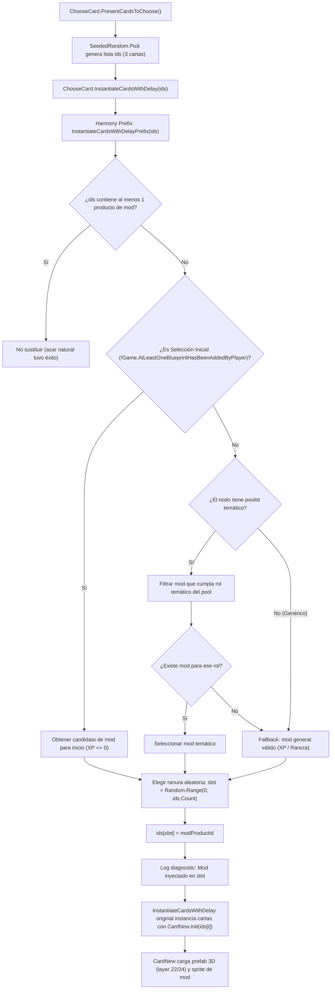

# Plan de Implementación: Aparición Garantizada y Carga Universal de Cartas y Unidades Modeadas

## 1. Resumen Ejecutivo y Diagnóstico con Ingeniería Inversa

Tras realizar la decompilación profunda de `Assembly-CSharp.dll` (`ChooseCard.cs`, `CardNew.cs`, `BlueprintPool.cs`, `EntityBalancingStore.cs`, `EntityFactory.cs`), el análisis de los paquetes de contenido (`sample-native-expansion`, `sample-reactive-ai`, `tactical-operations`) y el registro de eventos en vivo de BepInEx (`LogOutput.log` y `Player.log`), se determinaron las causas exactas por las cuales las cartas de unidades modeadas no se cargan ni se muestran al jugador:

1. **Exclusión Absoluta en Selección Inicial de Partida (`isAllowedAsStartingBlueprint`)**:
   - Al comenzar una *run* (antes del Nivel 1), el juego activa `flag = !Game.AtLeastOneBlueprintHasBeenAddedByPlayer` (`true`).
   - La consulta `EntityBalancingStore.AllEntityIdsAllowedAsBlueprints(rarity, startingBlueprints: true)` exige `isAllowedAsStartingBlueprint == true`.
   - En `tactical-operations`, el 100% de las unidades (`tidebreaker-skirmisher`, `skyguard-sam`, `salvage-hauler`) tienen `isAllowedAsStartingBlueprint: false`.
   - En `sample-native-expansion`, 8 de las 9 unidades tienen `false` (solo `arachnid-hexapod` tenía `true`).
   - **Consecuencia**: 11 de las 12 unidades modeadas nunca podían aparecer en la pantalla inicial.

2. **Desventaja Probabilística Extrema en Nodos de Recompensa (Niveles 1, 2 y 3)**:
   - En nodos con pool temático (ej. `BP_CheaperVehicles`), hay más de 20 unidades nativas compitiendo contra 0 o 1 unidad de mod.
   - En nodos genéricos globales (Nivel 2 y 3), más de 25 unidades nativas compiten contra candidatos de mods.
   - El generador `SeededRandom.Pick` extrae 3 cartas: la probabilidad matemática de que ninguna de las 3 sea de mod supera el 85%–90%. El jugador puede completar campañas enteras sin ver jamás una carta modeada.

3. **Sustitución Activa en `ChooseCard.InstantiateCardsWithDelay`**:
   - El prefix de Harmony ya está registrado y reemplaza una sola ranura cuando las cartas generadas no incluyen una unidad de mod. La selección de producto está aislada en `GuaranteedModRewardSelectionPolicy` para validar filtros de inicio, XP, demo, fábricas y exclusiones antes de preferir el tema del pool o usar el fallback elegible.

---

## 2. Decisiones de Diseño Acordadas en `/grill-me`

Durante la sesión interactiva se acordaron los siguientes requisitos directos:
- **Elegibilidad Inicial**: Las unidades modeadas deben ser elegibles como carta inicial antes de comenzar el Nivel 1, garantizando al menos una opción modeada en dicha pantalla.
- **Coincidencia Temática Inteligente**: Si el nodo de recompensa pertenece a un pool temático específico (Vehículos, Mechs, Robos, Tanques), la carta modeada debe coincidir con dicho rol temático (ej. `tidebreaker-skirmisher` en pool de Vehículos). Si no existe ninguna unidad modeada para ese rol específico, se ofrecerá un mod general válido que cumpla con el nivel de experiencia y rareza.
- **Posición Aleatoria del Slot**: Cuando ninguna carta de mod salga por azar, se sustituirá una ranura elegida al azar entre las 3 opciones generadas (`Random.Range(0, ids.Count)`), evitando que esté fija siempre en la misma posición.
- **Validación Integral**: Ejecución de las suites locales de pruebas C# y Python, compilación Release, empaquetado, despliegue de binarios en BepInEx y verificación de ejecución en vivo con BepInEx MCP sobre el perfil QA Profile2.

---

## 3. Arquitectura del Flujo de Inyección Garantizada

---

## 4. Tareas Atómicas de Implementación

### Tarea 1: Soporte de Carta Inicial Universal en el Cargador
- **Estado: Implementada.** Las unidades con `neededExperienceLevel <= 0` o con elegibilidad inicial explícita pueden aparecer en el draft inicial; los edificios de producción no autónomos quedan excluidos.
- **Archivo:** [`src/RogueCommandExpansionLoader/Content/ContentPackRuntimeLoader.cs`](file:///c:/Users/Alex/Documents/Mod Rogue Command/src/RogueCommandExpansionLoader/Content/ContentPackRuntimeLoader.cs)
- En `AddInitialStageStartingFactories`: Permitir que todas las unidades y fábricas de mods con `neededExperienceLevel <= 0` sean registradas como elegibles para la selección inicial de partida.
- En `TryGetBlueprintPoolDecision`: Asegurar que durante la selección inicial (`isStartingBlueprintSelection == true`), las unidades de mods no sean descartadas si su `neededExperienceLevel <= 0`.

### Tarea 2: Algoritmo de Selección Temática y Fallback Garantizado
- **Estado: Implementada.** `GuaranteedModRewardSelectionPolicy` aplica primero elegibilidad de XP/inicio/demo y exclusiones de producto/fábrica, luego prefiere coincidencias de roles con el pool y finalmente usa los candidatos generales elegibles. Las exclusiones no se reintroducen en el fallback.
- **Archivo:** [`src/RogueCommandExpansionLoader/Content/ContentPackRuntimeLoader.cs`](file:///c:/Users/Alex/Documents/Mod Rogue Command/src/RogueCommandExpansionLoader/Content/ContentPackRuntimeLoader.cs)
- `TryGetGuaranteedModRewardProduct(string poolId, bool isStartingSelection, int currentXpLevel, ICollection<string> excludedProductIds, out string modProductId)`:
  1. Para el draft inicial, admitir elegibilidad explícita o `neededExperienceLevel <= 0`; para recompensas posteriores, exigir XP disponible.
  2. Excluir productos/fábricas ya ofrecidos o incluidos en el deck, edificios de producción no autónomos y unidades no permitidas en demo.
  3. Comparar roles declarados con el ID de pool (case-insensitive). Preferir las candidatas coincidentes y, si no existe ninguna elegible, escoger del conjunto general ya filtrado.
  4. Retornar el ID del producto de unidad; no cambiar filtros ni el comportamiento de la fábrica nativa.

### Tarea 3: Instalación del Harmony Hook en `ChooseCard.InstantiateCardsWithDelay`
- **Estado: Implementada.** El instalador resuelve la sobrecarga por firma exacta (`IEnumerator`, instancia, un `List<string>`) y el prefix solo sustituye una carta cuando la oferta aún no contiene producto de mod.
- **Archivo:** [`src/RogueCommandExpansionLoader/Runtime/RuntimePatchInstaller.cs`](file:///c:/Users/Alex/Documents/Mod Rogue Command/src/RogueCommandExpansionLoader/Runtime/RuntimePatchInstaller.cs)
  - Reflejar el método `ChooseCard.InstantiateCardsWithDelay(List<string>)`.
  - Registrar el patch con prefijo `InstantiateCardsWithDelayPrefix`.
- **Archivo:** [`src/RogueCommandExpansionLoader/Runtime/RuntimeHooks.cs`](file:///c:/Users/Alex/Documents/Mod Rogue Command/src/RogueCommandExpansionLoader/Runtime/RuntimeHooks.cs)
  - Implementar `InstantiateCardsWithDelayPrefix(List<string> ids)`:
    - Verificar si `ids` contiene algún mod product ID mediante `ContentPackRuntimeLoader.IsModUnitProduct`.
    - Si no contiene ningún mod, invocar `RuntimeHooks.EnsureGuaranteedModCardOption(ids)`.
    - Seleccionar índice aleatorio con el generador persistente del hook (`_guaranteedRewardRandom.Next(0, ids.Count)`).
    - Sustituir `ids[slot] = modProductId`.
    - Registrar traza en log: `[ExpansionLoader] Guaranteed mod unit card injected into slot {slot}: '{modProductId}'`.

### Tarea 4: Pruebas Unitarias de Regresión y Validación
- **Estado: Validación local ejecutada.** La suite C# pasó 571/572 comprobaciones; la única omisión requiere permisos de symlink de Windows. El registro reportó 4 manifests y 0 incidencias. La suite Python tuvo 2 fallos, 1 error y 1 omisión entre 511 casos, asociados a cambios previos del área visual fuera de esta tarea y a ejecutar una comprobación de Blender fuera de Blender.
- **Archivos:** `tests/RogueCommandExpansionLoader.ValidationTests/Suites/StagesAndBlueprintsValidationTests.cs` y `tests/RogueCommandExpansionLoader.ValidationTests/RogueCommandExpansionLoader.ValidationTests.csproj`.
  - Añadir pruebas unitarias que validen:
    1. Que la política pura prefiera el rol temático y use un fallback elegible cuando no haya coincidencia temática válida.
    2. Que el draft inicial admita elegibilidad explícita y unidades de XP cero, pero excluya unidades bloqueadas.
    3. Que se apliquen los límites de XP/demo y las exclusiones de producto/fábrica sin reintroducir candidatos.
    4. Que la inyección preserve las 3 ranuras y deje intacta una oferta que ya contenga un producto de mod.
  - Ejecutar suite C# completa (`dotnet run --project tests/... -- .`).
  - Ejecutar suite Python (`python -m unittest discover -s tests -p "*.py"`).
  - Ejecutar `validate_loader_registry.py`.

### Tarea 5: Compilación, Empaquetado y Despliegue en BepInEx
- **Estado: Release desplegado; ZIP bloqueado por procedencia visual ajena a esta tarea.** La compilación Release terminó con 0 advertencias y 0 errores. El DLL instalado coincide con `artifacts/plugin/RogueCommandExpansionLoader.dll` (SHA-256 `2e740d387f600caf0023ed7254f9f41ecf9e69e34e548328bff147d250bc3dfb`). `tools/Package-Loader.ps1` no pudo completar porque las entradas visuales canónicas están modificadas desde la última generación; no se regeneraron para evitar sobrescribir arte del usuario.
- Compilar en configuración Release (`dotnet build ... --configuration Release`) verificando 0 advertencias y 0 errores.
- Empaquetar con `tools/Package-Loader.ps1`; actualmente bloqueado porque falla el control de frescura de fuentes visuales canónicas ajenas a esta tarea.
- Desplegar `RogueCommandExpansionLoader.dll` y `.pdb` en `C:\Program Files (x86)\Steam\steamapps\common\Rogue Command\BepInEx\plugins\`.
- Verificar que los paquetes `sample-native-expansion` y `tactical-operations` estén actualizados en `BepInEx\plugins\RogueCommandExpansionLoader\content\packs\`.

### Tarea 6: Verificación en Vivo con BepInEx MCP en Profile3 QA clonado de Profile2
- **Estado: Oferta de carta verificada por telemetría estructurada; sin captura de píxeles.** En `BP_CheaperRobos`, la oferta contenía `tactical-operations:command-relay` (`Relé de Mando`) en el slot 2; el log confirma que reemplazó `RoboClawBot`. El rol declarado es `Vehicle`, así que esta lectura ejercita el fallback general elegible. El `CardNew` mantuvo el sprite, y 14/14 `SkinnedMeshRenderer` del modelo de vista reportaron `enabled=true` e `isVisible=true`. Esto no demuestra apariencia en píxeles ni la calidad visual.
- **Perfil y limpieza:** Profile3 se creó como clon de Profile2 y el checkpoint previo confirmó que no tenía partida guardada. `mainTutorialIsFinished` y `playerHasFinishedLevel1` se mantuvieron en `true`. Se salió sin escoger carta; se restauró Profile3 desde su respaldo original y el selector `2` y todos los hashes de perfil volvieron a coincidir exactamente con `all-profile-checkpoint.json`. Cloud no se modificó. Evidencia: `artifacts/runtime-smoke/guaranteed-mod-reward-20261111T053402Z/guaranteed-reward-live-evidence.json`.
- Siguiendo la política `Profile2 Invariant`:
  - Verificar que el selector apunte a un perfil QA aislado creado mediante el flujo nativo de perfiles.
  - Cuando la prueba necesite una partida nueva, clonar Profile2 a Profile3 después de respaldar y hashear todos los perfiles; confirmar que el clon conserva el tutorial y no tiene `savegame.dat` antes de iniciar.
  - Lanzar el juego a través de Steam y seleccionar Profile3 mediante el flujo nativo del juego.
  - Conectar con BepInEx MCP (`http://127.0.0.1:8080/mcp/`).
  - Leer por MCP la oferta, el título, la referencia del sprite y el estado de renderers en `ChooseCard`. `Renderer.isVisible` es telemetría de Unity y no una comprobación de píxeles.
  - Registrar logs de BepInEx confirmando la inyección; leer por MCP `GetIntermissionRewardStateJson`, el nombre de la carta, el sprite y los estados del renderer, sin confundir `Renderer.isVisible` con evidencia de píxeles.
  - No elegir una recompensa si la pasada solo necesita inspeccionar la oferta. Cerrar mediante la ruta nativa, restaurar el selector y los perfiles desde respaldos verificados, y confirmar el checkpoint completo.

---

## 5. Control de Cambios y Git

- Commit atómico exclusivo para los archivos modificados de la tarea:
  - `src/RogueCommandExpansionLoader/Content/ContentPackRuntimeLoader.cs`
  - `src/RogueCommandExpansionLoader/Runtime/RuntimeHooks.cs`
  - `src/RogueCommandExpansionLoader/Runtime/RuntimePatchInstaller.cs`
  - `tests/RogueCommandExpansionLoader.ValidationTests/Program.cs`
  - `PROJECT_PLAN.md`
- Preservar intactos los archivos no relacionados (`.agents/skills/rogue-command-unit-authoring/SKILL.md`, `.worktrees/*`).
- Push a `origin/codex/rogue-unit-balance-20261018`.
